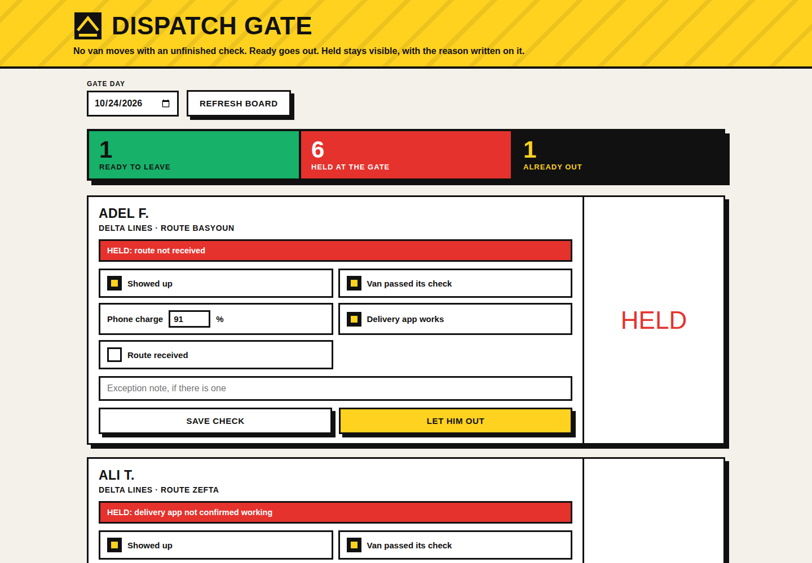

# Dispatch Ready

Morning at a station is a gate, whether it is written down or not. A courier either leaves ready or leaves to become somebody else's problem by noon. This app writes the gate down.

For every courier, every morning, one checklist: he showed up, the van passed its check, his phone is charged enough to survive the route, the delivery app actually works on that phone, and he received his route. The gate rule is simple and the app enforces it in the backend, not just on the screen. If any item is missing, the depart action is refused and the answer says exactly which item is holding him. Once he fixes it, the same screen lets him out.

Blocked couriers are not just red rows. Each one carries the reason he is blocked and, where the yard lead wrote one, the exception note: charger broken, waiting on a power bank from the store, tyre reported to maintenance, app reinstalling. By eight in the morning the lead can see the whole yard as three numbers: ready, blocked, and already out.

## Run it

```bash
cd backend
python3 seed.py
python3 app.py
```

Open http://127.0.0.1:8082 and sign in with the demo yard lead account, yardlead / demo1234. Local demo account, printed on purpose. A second read only account, yardview / view1234, exists so the admin only routes can be told apart from ordinary use. The phone threshold is 30 percent, set in one place at the top of backend/app.py, because a phone at 12 percent is a courier who goes dark at midday.

## What it does now

- The morning board with ready, blocked and departed counts, and the gate rule enforced in the backend.
- CSV import for checklist sheets, described below.
- Charts drawn as inline SVG from live API data: ready and departed against blocked per day, and blocker reason totals for the period. No chart library, no CDN.
- A printable daily or weekly report view on the page. Print shows only the report summary and its per day table.
- Structured JSON errors everywhere. Every failure answers `{"ok": false, "error": {"code": ..., "message": ...}}`, and a refused departure still carries its `blockers` list next to the error.
- A rotating log file next to the backend, configuration through environment variables, and an admin only backup endpoint.

## CSV import

POST the raw CSV text to `/api/import` with the bearer token. The body is the file itself, capped at 500 KB.

Required columns: `courier_id, day, attendance, vehicle_ok, phone_pct, app_ok, route_received`. `exception_reason` is optional, and `phone_pct` may be left empty for a courier whose phone was never read. The four checklist values accept 1, 0, true, false, yes or no. A file missing a required column is refused whole with a 400 that names the missing columns.

The natural key of a checklist entry is the courier plus the day. Importing a row for a courier and day that already has a checklist is a duplicate: it is named in `skipped_duplicates` and the existing entry is left exactly as the yard lead recorded it, never overwritten by a spreadsheet. The reply names everything:

```json
{"ok": true, "inserted": 1,
 "skipped_duplicates": [{"courier_id": 1, "day": "2026-10-24"}],
 "rejected_rows": [{"row": 4, "courier_id": 5, "day": "2026-10-25", "reason": "phone_pct 140 is outside 0 to 100"}],
 "total_rows": 3}
```

Rows with an unknown courier, a backwards or impossible date, a non boolean checklist value, or a phone charge outside 0 to 100 land in `rejected_rows` with their CSV line number and the reason. Nothing is silently swallowed.

## Configuration

Settings come from environment variables, see `config.env.example`:

| Variable | Default | Meaning |
| --- | --- | --- |
| `PORT` | 8082 | Port the server listens on |
| `DB_PATH` | backend/dispatch.db | SQLite database file |
| `LOG_PATH` | backend/dispatch.log | Rotating log file, 256 KB per file, three kept |
| `BACKUP_DIR` | backend/backups | Where backup copies land |

## Backup and restore

`POST /api/admin/backup` with the yard lead token copies the live database into the backup directory under a timestamped name such as `dispatch-backup-20261024-063000.db` and returns that name and its size. The copy is made with the SQLite backup API, so it is a consistent database even while the app is running. Viewer accounts get a 403.

To restore: stop the server, copy the chosen backup file over the database path from `DB_PATH`, and start the server again.

```bash
cp backend/backups/dispatch-backup-20261024-063000.db backend/dispatch.db
```

## Architecture

Python 3 standard library only. REST API plus SQLite in the backend, one page frontend that calls the API. Passwords are PBKDF2 hashed, routes sit behind a bearer token, SQL is parameterised, checklist values are validated before they are stored. New in this round: a CSV import handler on the stdlib csv module, a `/api/report` range endpoint that replays the gate rule day by day to build the ready and blocked trend and the blocker reason totals, a rotating file logger from logging.handlers, and the backup endpoint described above. The page builds its charts as inline SVG strings and carries a print stylesheet for the report view. It is responsive and built for big touch targets, so it works from a computer, an Android phone, and an iOS phone. The yard lead realistically uses it on a phone standing by the vans. This demo runs locally and has no public deployment.

Tests: `python3 tests/test_api.py` walks the original gate workflow, and `python3 tests/test_deepening.py` boots the server on its own port against a throwaway database and covers the import report, the backup file, the configuration variables and the report shape.

## Known limitations

The checklist is per courier per day, entered by the yard lead. It does not read the van or the phone by itself, no telematics, no device agent. A courier who lies on the van check still lies here, the difference is that the lie is now a record with his name and the time on it.

The report totals are day sums, so a courier blocked on three mornings counts three times in a weekly blocker total. That is deliberate, the yard feels him three times, but it is not a per courier absence ranking. The import holds the whole file in memory and report ranges are capped at 63 days, both fine at one station's scale. Login tokens live in server memory, so a restart signs everyone out, backups are local files only, and restores are a manual file copy on purpose.

## Screenshots



The gate at the start of a day on the seeded demo data: one courier
ready, six held, one already out. A ready courier's slab at full size
is in [docs/screenshot-states.png](docs/screenshot-states.png). All
data on these screens is fictional demo data.
